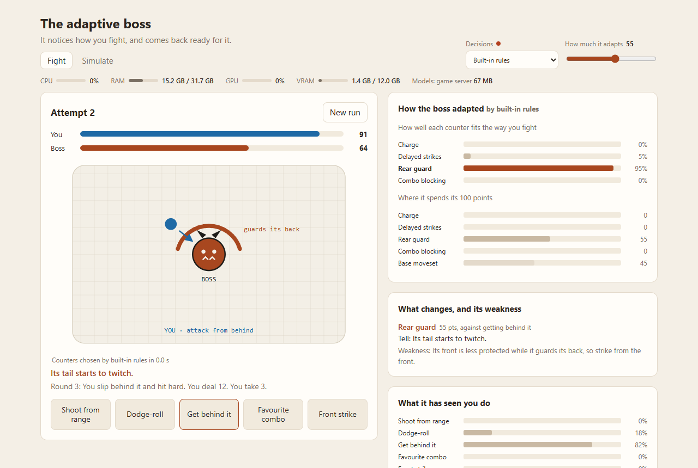

# adaptive-bosses

A boss fight where the boss notices how you fight and comes back ready for it. Keep attacking from behind and it learns to guard its back. Keep shooting from range and it learns to charge. Every counter it buys has a warning sign you can learn to read and a weakness you can punish.

It is a playable prototype of the sketch on my [research page](https://girhe.com/research#sketch-boss). The sketch is an illustrative model with sliders; this version is a real fight, and the boss's choices come from a local AI model.



## How it works

You fight in rounds. At the start of each round the boss either uses its base attack or one of the counters it has bought, and a counter always shows its tell first ("Its tail starts to twitch"). You pick a move: shoot from range, dodge-roll, get behind it, use your favourite combo, or strike from the front.

| Counter | Bought against | Tell | Weakness |
|---|---|---|---|
| Charge | shooting from range | It crouches and roars | stuck after the charge; dodge-roll for free hits |
| Delayed strikes | dodge-rolling | It holds its swing | slower; a front strike interrupts it |
| Rear guard | getting behind it | Its tail twitches | its front is open; strike from the front |
| Combo blocking | your favourite combo | It watches your hands | any other opener catches it off guard |

Between attempts the boss adapts. A typed decision model reads a summary of how you have been fighting (which moves you lean on, with recent attempts counting more, and how often you answered a tell with the right move) and scores the four counters. The boss splits its counter budget by those scores. "How much it adapts" sets the budget out of 100 points; whatever it doesn't spend stays in its base moveset. This runs on [GLiClass](https://github.com/Knowledgator/GLiClass), an open-source zero-shot classifier.

GLiClass can be missing. Without it, built-in rules from the sketch make the decision: the boss spends in proportion to the square of each habit's share, so it leans hardest into your strongest habit.

The cards beside the fight show how well each counter fit the way you fight, where the boss spent its points, what each counter changes and how to beat it, what the boss has seen you do, and how hard each attempt was. "Behind the scenes" shows the text the decision model read. A bar under the title shows CPU, RAM, GPU and VRAM use, and how much memory the decision model takes.

## Running it

You need Node 20 or newer.

```sh
npm ci
npm start
```

Then open http://localhost:4330.

That runs the built-in rules. To add the decision model:

```sh
# the decision model (Python 3.10+; downloads the model on first run)
pip install -r decider/requirements.txt
python decider/server.py
```

Leave it running and reload the page. The menu at the top picks the decision model, and the dot next to it shows whether it is running.

GLiClass uses `knowledgator/gliclass-small-v1.0` by default and runs on the GPU if PyTorch can see one. Set `GLICLASS_MODEL` to try another GLiClass model, or `DECIDER_URL` if the service runs somewhere else. GPU stats need an NVIDIA card with `nvidia-smi`.

## Simulate

The Simulate tab has bot players with fixed habits (attacks from behind, fights from range, dodges, repeats a combo, varies everything) fight a static boss and an adaptive boss for a number of attempts. Each bot gets better every attempt: it learns to read the tells and to beat the base moveset. That is the assumption the sketch makes about players, played out instead of drawn.

It shows how hard each attempt was for both bosses against the 35 to 60% target band from the sketch, how each bot did, and how long every decision took (in total and inside GLiClass), with fallbacks and memory use. Results download as JSON.

The same thing runs from the command line and saves to `simulations/`:

```sh
npm run simulate -- --attempts 12 --strength 55 --decider gliclass
```

In Windows PowerShell, quote the separator: `npm run simulate '--' --attempts 12 ...`.

With the built-in rules, five bots and twelve attempts (`npm run simulate -- --decider rules`, seed 1), the static boss drops to about 30% challenge as the bots learn it and only 13% of later attempts land in the target band. The adaptive boss stays around 40%, with 60% of later attempts in the band. It is hardest right after the first attempt (60% on average), when it suddenly counters a habit the bot hasn't learned to read yet. These are bots, not people; whether the adaptive fights feel fair is a question for player tests.

## Layout

```
src/fight.ts          moves, counters, tells and weaknesses, and the seeded fight
src/habits.ts         what the boss has noticed about the player
src/decision.ts       the habits as text, the counters, GLiClass and the fallback
src/rules.ts          the built-in budget rules from the sketch
src/game.ts           a run: play rounds, then adapt between attempts
src/simulate.ts       bots against a static and an adaptive boss (src/simulate-cli.ts runs it)
src/system.ts         CPU, RAM and GPU stats for the page
src/server.ts         local server for the page
decider/              GLiClass behind a small HTTP service
web/                  the page (plain HTML, CSS and JavaScript)
test/                 tests, with the model services faked
```

## Tests

```sh
npm test
```

## License

MIT
